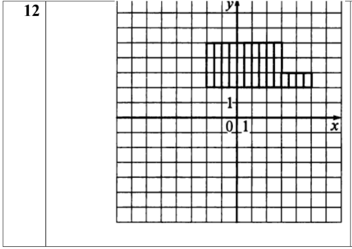
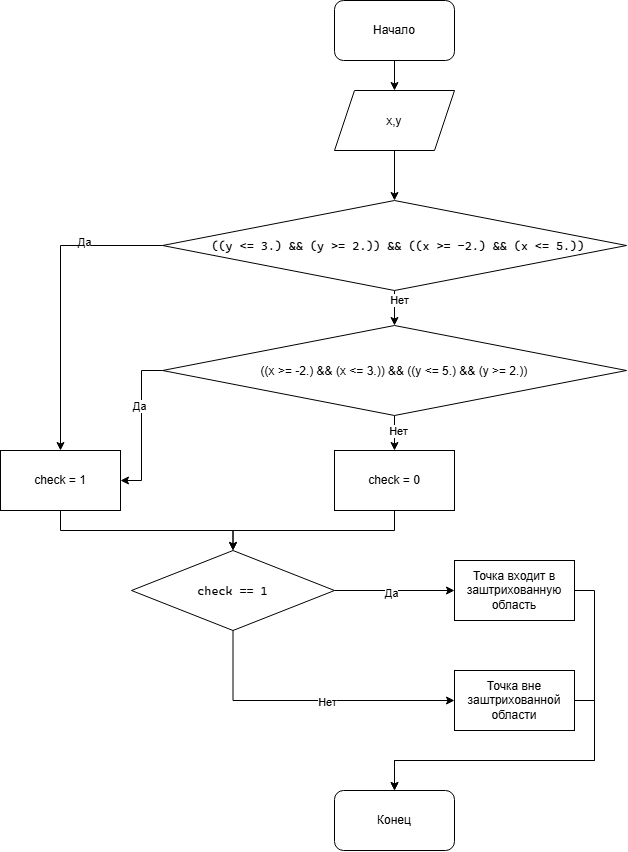

# Домашнее задание к работе 6

## Условие задачи
Составить программу, которая проверяет принадлежит ли заданная пользователем точка с
координатами (х, у) заданным закрашенным (заштрихованным) областям, показанным на рисунках
в табл., и выводит на экран сообщение.

### Заштрихованная область:



## 1. Алгоритм и блок-схема

### Алгоритм
1. **Начало**
2. Задать исходные данные:
   - `x` - координата точки абсцисс 
   - `y` - координата точки ординат
   - `check` - переменная которая принимает значения 1/0
3. Произвести проверку на вхождение точки в заштрихованные участки графика:
4. Вывести результат проверки.
5. **Конец**

### Блок-схема



## 2. Реализация программы
```
#define _CRT_SECURE_NO_WARNINGS
#include <stdio.h>
#include <locale.h>
#include <math.h>
int main()
{
	setlocale(LC_ALL, "RUS");
	double x, y;
	printf("Введите координаты x,y через пробел: ");
	scanf("%lf %lf",&x,&y);
	int check = 0;
	if (((y <= 3.) && (y >= 2.)) && ((x >= -2.) && (x <= 5.))) check = 1;
	else if ( ((x >= -2.) && (x <= 3.)) && ((y <= 5.) && (y >= 2.)) )
	{
		check = 1;
	}
	if (check == 1) printf("Точка входит в заштрихованную область \n");
	else printf("Точка вне заштрихованной области");
}
```
## 3. Результаты работы программы

Точка входит в заштрихованную область / Точка вне заштрихованной области

## 4. Информация о разработчике

Ляховский Сергей бИЦТ - 262
